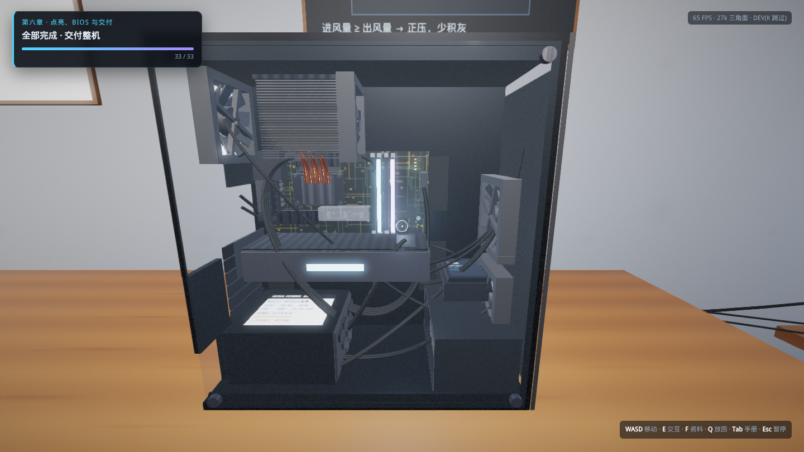
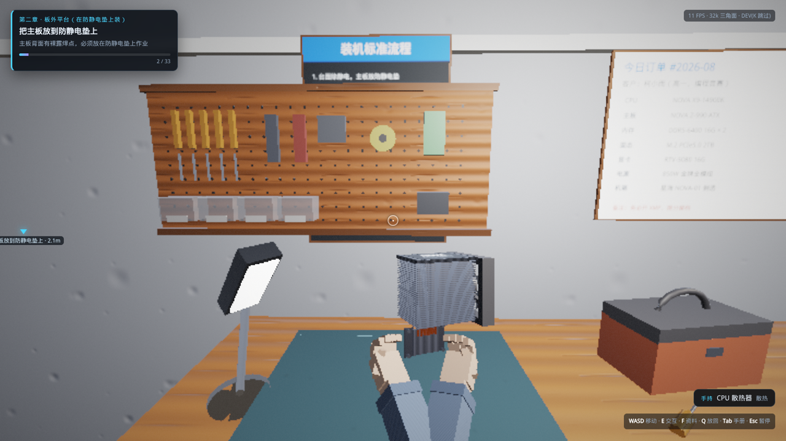
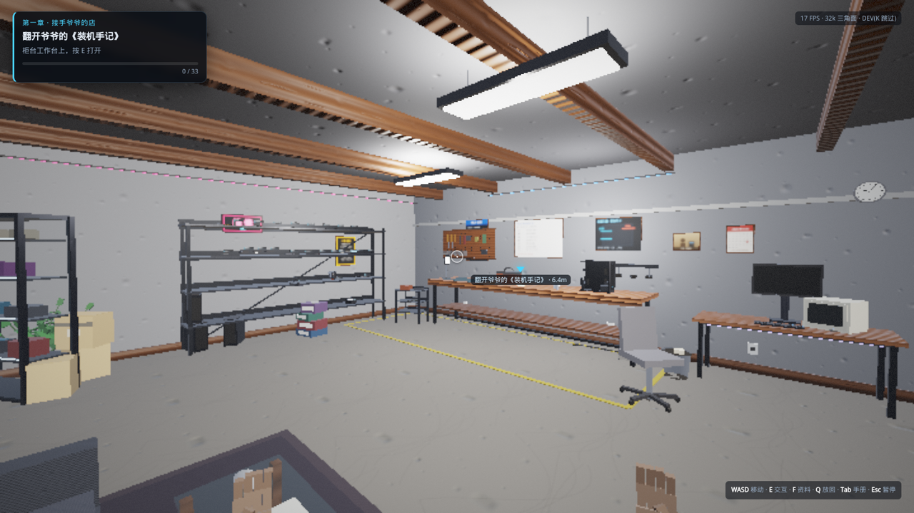

# 装机模拟器 3D · 星海电脑维修部

第一人称 3D 装机模拟器：有剧情、有教学、可交互，**单个 HTML 文件即可运行**（双击打开就能玩，不需要联网、不需要安装任何东西）。

> 直接玩：下载并双击 **[`pc-build-simulator-3d.html`](pc-build-simulator-3d.html)**（推荐 Chrome / Edge / Firefox 新版本）。







## 这是什么

你继承了爷爷的老店「星海电脑维修部」，柜台上压着最后一张没做完的订单。
玩家以第一人称走进店里，从货架上认识零件开始，把一台整机**一颗螺丝、一根线地装起来并点亮**：

- **6 个章节 / 33 个步骤**：认识零件 → 板外平台 → 主板入箱 → 装大件 → 走线合盖 → 点亮 / BIOS / 装系统 / 跑分交付。
- **30+ 张硬件知识卡片**：每装一件都会讲清「它是干什么的、为什么这样装、装错会怎样」。
- **前置条件教学**：顺序错了不会硬拦一句"不行"，而是告诉你原因（例如没装铜柱就装主板 = 通电短路；没涂硅脂就压散热器 = 得整个拆了重做）。
- **真实零件**：CPU / 主板 / DDR5 内存 ×2 / M.2 固态 + 马甲 / 硅脂 / 塔式风冷 / 显卡 / 电源 / SATA 固态 / 机械硬盘 / 机箱风扇 ×3 / 铜柱与螺丝 / 24pin / EPS 8pin / PCIe 8pin / SATA 供电与数据 / 前面板跳线 / 风扇线 / Wi-Fi 天线 / 侧透玻璃侧板 / 显示器键鼠与市电。
- **点亮全流程**：按下电源键 → 风扇转起、RGB 亮起 → POST 自检画面 → 进 BIOS 开 XMP → 装系统 → 跑分 → 交付并结算评级。

## 操作

| 按键 | 作用 |
| --- | --- |
| `W` `A` `S` `D` | 走动（`Shift` 疾走，`Space` 跳，`C` / `Ctrl` 下蹲看机箱底部） |
| 鼠标 / 方向键 | 环视（点击画面锁定指针，`Esc` 释放） |
| `E` | 拾取 / 安装 / 交互（开电源键、翻手记、进 BIOS） |
| `F` | 查看手中或准星指向零件的详细资料 |
| `Q` | 把手里的零件放回原处（回到它上一次待的位置，不是回货架） |
| `Tab` | 装机手册（任务进度 + 已收集知识卡片） |
| `Esc` | 暂停菜单（画质设置、操作说明、重新开始） |

准星变**青色**＝可以操作；变**红色**＝前置步骤没完成，屏幕会说明原因。手持零件靠近安装位时，会出现半透明的「幽灵零件」预览（青色＝可安装，琥珀色＝放回原处）。

**第一人称双手**：空手时手垂在画面下沿，拿起零件后双手会按零件尺寸从下方托住它，走动时随步伐轻微晃动，按 `E` 交互时有向前一送的动作。手部作为独立的 viewmodel 绘制，不会插进桌面或机箱里。

**零件随时可以放回**：任何已放置的零件，只要它的后续步骤还没做完就能重新拿起来；对准它原来待的位置会提示「放回××」，按 `E` 或 `Q` 都能放回去（例如主板从防静电垫上拿起来后，还能原样放回垫子上）。

## 技术实现

没有使用任何三方引擎或素材，全部为手写代码 + 程序化生成，因此可以塞进一个 HTML 文件：

- **渲染**：原生 WebGL2 前向渲染管线 —— GGX/Cook-Torrance PBR 着色、平行光阴影贴图（2048² + PCF）、半球环境光、HDR 帧缓冲 + 阈值泛光、ACES 色调映射、FXAA、雾与暗角。
- **材质**：所有贴图在运行时用可平铺的分形噪声 + Canvas 2D 绘制生成（混凝土、木纹、拉丝钢、铝、PCB 走线与丝印、编织布、蜂窝网、铜、金手指……），并由高度图现场生成法线贴图；零件铭牌、墙面教学海报、BIOS/系统画面都是 Canvas 实时绘制的纹理。
- **几何**：自研几何构建器（长方体 / 圆柱 / 球 / 贝塞尔管道 + 变换栈），按材质合批；场景图支持层级变换，所以「主板连着 CPU、内存、散热器一起装进机箱」是真正的父子关系搬运。
- **音效**：WebAudio 程序化合成（卡扣声、螺丝声、风扇底噪随转速变化、POST 蜂鸣、开机音）。
- **交互**：锥形准星判定 + AABB 拾取、前置条件状态机、安装动画、目标指示罗盘；零件记录「上一次落点」，因此可以原样放回。
- **第一人称手**：低模手掌 / 手指 / 袖口，握持与松弛两套姿态，绘制前单独清一次深度缓冲（viewmodel 通道），避免与场景物体互相穿插。
- **场景**：工具挂板、线材卷架、玻璃展示柜（内置灯带）、等候区沙发与茶几、壁挂电视与易拉宝（Canvas 绘制画面）、霓虹招牌、天花板灯槽灯带、窗外城市天际线、地面警示线等程序化道具。

单文件约 290 KB，无外部请求。

## 源码结构与构建

`pc-build-simulator-3d.html` 是构建产物；源码按模块拆在 `sim3d/src/` 下：

```
sim3d/
  index.html          开发用页面（含全部 UI 与样式）
  build.mjs           打包脚本：把 index.html + src/*.js 内联成单文件
  src/00-math.js      矩阵 / 向量
  src/01-gl.js        WebGL2 封装（着色器、纹理、FBO、VAO）
  src/02-textures.js  程序化纹理与法线贴图
  src/03-geom.js      几何构建器
  src/04-render.js    PBR + 阴影 + 泛光 + 后处理
  src/05-scene.js     场景图与射线拾取
  src/06-player.js    第一人称控制器与碰撞
  src/07-models-room.js  房间与家具道具
  src/08-models-hw.js    全部硬件模型
  src/09-labels.js    铭牌 / 海报 / 白板文字
  src/10-modelreg.js  模型注册表
  src/11-parts.js     零件资料库与 33 个装机步骤（教学文案）
  src/12-world.js     世界搭建（灯光、碰撞、零件摆放）
  src/13-screens.js   显示器画面（POST / BIOS / 装系统 / 跑分）
  src/14-audio.js     程序化音效
  src/15-ui.js        HUD、对话、知识卡片、结算
  src/16-game.js      主循环与游戏逻辑
```

开发方式：

```bash
cd sim3d
python3 -m http.server 8080     # 然后访问 http://localhost:8080/sim3d/index.html
node build.mjs                  # 重新生成根目录的 pc-build-simulator-3d.html
```

调试参数：在链接后加 `?dev=1`，可用 `K` 键一键完成当前步骤（用于快速验证后续章节）。

## 性能与兼容

- 需要支持 WebGL2 的浏览器（Chrome / Edge / Firefox / Safari 16+）。
- **自适应画质**：运行时会监测帧率，低于 26 FPS 会自动逐级降低渲染分辨率、阴影、泛光与光源数量，并提示一次；一旦你在设置里手动调过画质，就不再自动干预。
- 独立显卡上通常远超 60 FPS。若想手动调整，按 `Esc` → 设置：渲染分辨率、阴影、泛光、FXAA、鼠标灵敏度、音效都可单独开关。
- 纯软件渲染（无 GPU 加速的虚拟机）也能跑完全程，只是帧率会明显下降。
- 移动位移按帧时间积分并做了分步碰撞，低帧率下不会变慢或穿墙。
- 全部 33 个步骤有自动化回归脚本覆盖（拾取 → 放下 → 再拾取 → 安装），确保没有「拿起来放不回去」这类死结。
